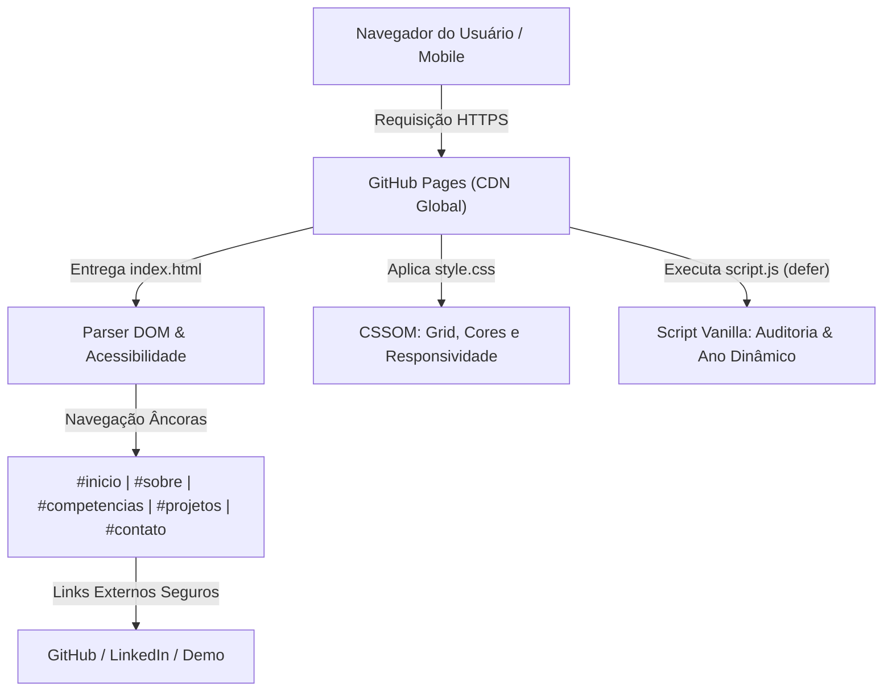

# High-Level Design (HLD)

Status: APPROVED

## Arquitetura Adotada
Arquitetura estática baseada na tríade fundamental da web (**HTML5, CSS3 e JavaScript Vanilla**), hospedada no **GitHub Pages**.

## Limites e Componentes
1. **Cabeçalho Fixo (`header`):** Logotipo textual (`Luis Roberto`) e barra de navegação (`nav aria-label="Menu principal"`).
2. **Hero (`section.hero`):** Apresentação concisa, badge de disponibilidade, cargo e chamadas para ação (CTAs).
3. **Sobre mim (`section#sobre`):** Trajetória acadêmica na FAMETRO e vivência corporativa em sistemas e automação.
4. **Competências (`section#competencias`):** Quatro quadrantes temáticos (Frontend, Backend, Automação/Dados e Soft Skills).
5. **Projetos (`section#projetos`):** Cards detalhando projetos reais (`BioTrack`, `Mover`, `Total Look`, `PsyAntiCheat-REDM`), com problema, solução, resultado, tags técnicas e links.
6. **Contato (`section#contato`):** Informações profissionais seguras (GitHub, LinkedIn, E-mail profissional e Cidade).
7. **Rodapé (`footer`):** Identificação acadêmica e ano atualizado dinamicamente.
